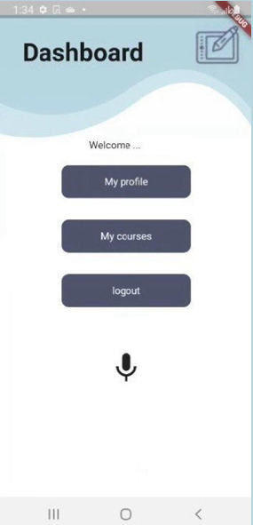

# Vocal Learning

**A voice-based mobile application that helps blind and visually impaired students access course content and take multiple-choice exams independently.**

## Application Screenshots

<table>
  <tr>
    <td align="center">
      <b>Register</b> 
      
    </td>
    <td align="center">
      <b>Login</b> 
      
    </td>
    <td align="center">
      <b>Dashboard</b> 
      
    </td>
  </tr>
</table>

> Graduation project, Department of Information Technology, College of Computers and Information Technology, Taif University, Saudi Arabia.
> This repository is **documentation only**. The source code is not published.

---

## Table of Contents

1. [Project Overview](#project-overview)
2. [Problem Statement](#problem-statement)
3. [Project Objectives](#project-objectives)
4. [Target Audience](#target-audience)
5. [Key Features](#key-features)
6. [How It Works](#how-it-works)
7. [Technologies Used](#technologies-used)
8. [System Overview](#system-overview)
9. [My Role and Contributions](#my-role-and-contributions)
10. [Project Impact and Validation](#project-impact-and-validation)
11. [Screenshots and Demo](#screenshots-and-demo)
12. [Future Work](#future-work)
13. [Project Team](#project-team)
14. [Academic Project Notice](#academic-project-notice)

---

## Project Overview

Vocal Learning is a mobile application that uses Artificial Intelligence, Speech-to-Text (STT) and Text-to-Speech (TTS) so that blind students can listen to exam questions, answer them by voice, and review their grades without a sighted person reading questions or recording answers.

Teachers prepare multiple-choice questions for their courses. Students interact with the application through spoken commands and audio output. The interface supports English and Arabic.

## Problem Statement

Blind students commonly depend on sighted individuals to read exam questions aloud and write down their answers. This dependence can be:

- **Limiting and inconvenient**, because students must rely on the availability and schedules of other people.
- **Costly**, because sighted assistance can involve additional fees or expenses.

In addition, many educational applications are not designed for the needs of blind users, so students cannot benefit from them fully.

## Project Objectives

1. Provide blind students with an accessible application for online learning.
2. Reduce their dependence on the assistance of other people.
3. Help blind students access their registered courses through the application.
4. Enable blind students to view their scores for tests and assignments.
5. Enable interaction with educational materials through voice commands.
6. Enhance the independence and self-reliance of blind students.

**Scope.** The project covers multiple-choice quizzes, where the student selects the correct answer from the options presented.

## Target Audience

| Audience | Intended use |
|---|---|
| Blind and visually impaired students | Listen to questions, answer by voice, check grades |
| Teachers | Create and manage multiple-choice questions for their courses |
| Administrators | Manage user accounts (defined in the requirements; see the note in [Key Features](#key-features)) |

## Key Features

The features below are taken from the project report, presentation and interface screenshots.

**Voice interaction**
- Voice and typed input on the registration and login screens.
- Voice navigation: a microphone control on the dashboard and course screens lets the student choose actions by speaking, for example "Start a quiz", "Grades" or "Back".
- Spoken (TTS) output so the student can listen to the available options and content.

**Accounts**
- Registration with full name, mobile number, email, username and password, with a choice of account type (Teacher or Student).
- Login with username and password, and a "Forgot password" option.
- English and Arabic language selection on the login screen.

**Student functions**
- Dashboard with My Profile, My Courses and Logout.
- Course details page with Start a Quiz, Grades and Back.
- Multiple-choice quizzes and score viewing.

**Teacher functions**
- Create multiple-choice questions for a course.
- View the list of questions and delete questions.

## How It Works

1. **Register or log in.** A user creates an account as a Teacher or a Student, by typing or by voice, and logs in.
2. **Teacher prepares content.** The teacher creates questions, each with a question text, answer choices and a correct answer, and attaches them to a course.
3. **Student navigates by voice.** From the dashboard, the student opens a course and speaks a command such as "Start a quiz".
4. **Student listens and answers.** The application reads each question and its choices aloud (TTS). The student answers by voice, which is converted to text (STT).
5. **Scoring and review.** The answers are stored and a score is calculated. The student can open "Grades" to review results.

## Technologies Used

Only technologies named in the project report are listed.

| Category | Technology |
|---|---|
| AI and voice | Speech-to-Text (STT), Text-to-Speech (TTS) |
| Web and server-side languages | HTML, CSS, JavaScript, PHP |
| Database | MySQL |
| Local server | Apache (bundled with XAMPP) |
| Development tools | Visual Studio, Android Studio |
| Design and modelling | Figma (interface prototypes), draw.io (UML and ER diagrams) |
| Testing device | Android mobile device |
| Collaboration and documentation | Zoom, Microsoft Word, Google Forms (questionnaire), Canva (poster) |

## System Overview

**Development methodology.** The team followed an Agile, iterative approach, organised in six phases: Concept, Inception, Iteration, Testing, Production/Release and Review.

**Actors.** Blind learner (studies courses and takes quizzes), Teacher (creates courses and questions), Administrator (manages user accounts).

**Data model.** The relational database contains six tables:

| Table | Purpose |
|---|---|
| `user_type` | Account types (for example Teacher, Student) |
| `Users` | Account details: name, email, mobile, username, password, type |
| `Courses` | Course name and course owner |
| `Course_user` | Links users to the courses they are enrolled in |
| `Questions` | Question text, answer choices and correct answer, linked to a course |
| `Quizzes` | A student's quiz: question list, answers, start and end time, score, status |

**Diagrams.** The use case, class, sequence and ER diagrams and the relational schema are described in [`docs/system-architecture.md`](docs/system-architecture.md).

## My Role and Contributions

I served as the **Team Leader and Main Contributor** of a four-member team, taking a leading role in the development and implementation of the Vocal Learning application.

My responsibilities and contributions included:

- Leading the team and coordinating the overall project development process.
- Contributing extensively to the application's design, development, and implementation.
- Working on the integration of AI-powered features, including Speech-to-Text (STT) and Text-to-Speech (TTS).
- Contributing to the development of the application's core functionalities, testing, and documentation.

The project was developed collaboratively by all four team members, with contributions made throughout different stages of the project rather than through formally assigned technical roles.

## Project Impact and Validation

**Questionnaire.** The team ran an online questionnaire (Google Forms, 13 questions) and collected **61 responses**. Selected results reported in the project report:

| Question | Result |
|---|---|
| Will the application be useful for blind students? | 100% yes |
| Will it help blind students improve their academic level? | 98.3% yes |
| Will it help blind students become more independent? | 94.8% yes |
| Preferred application language | 89.7% both Arabic and English, 8.6% Arabic, 3% English |
| Would download it if available in an app store | 74.6% yes |

**Important context.** Per the report, 96.6% of respondents were not blind, and 91.2% were female. These results therefore reflect general opinion about the concept and are **not** a usability evaluation by blind users.

**Related work.** The report compares Vocal Learning with 15 existing assistive applications (including Be My Eyes, Seeing AI, Voice Dream Reader, KNFB Reader and Capti Voice). In the report's comparison, Vocal Learning is the only one that combines support for visually impaired users, educational institutions and voice recognition.

**Not claimed.** The project did not report a formal usability study with blind students, performance measurements or a public deployment.

## Screenshots and Demo

### Application Pages

<table>
  <tr>
    <th>Register</th>
    <th>Login</th>
    <th>Dashboard</th>
  </tr>
  <tr>
    <td align="center">
      
    </td>
    <td align="center">
      
    </td>
    <td align="center">
      
    </td>
  </tr>
</table>

### Course Management

<table>
  <tr>
    <th>Course details (student)</th>
    <th>Questions (teacher)</th>
  </tr>
  <tr>
    <td align="center">
      
    </td>
    <td align="center">
      
    </td>
  </tr>
</table>

## Future Work

As stated in the project report and presentation:

- Regular updates to extend functionality and improve the user experience.
- Expansion beyond Saudi Arabia to benefit visually impaired users in other countries.
- Allowing students to enroll in courses through the application.
- Improving Arabic pronunciation and adding support for more languages.
- Supporting blind students in attending lectures as well as taking exams.

## Project Team

| Name | Role |
|---|---|
| Jumanah Abdullah Alqathami | Project Leader & Main Contributo |
| Rafif Mohsen Alwathenani | Team Member |
| Abeer Shaba Alosaimi | Team Member |
| Raneem Abdullah Aljuaid | Team Member |

**Supervisor:** Dr. Samah Alajmani

## Academic Project Notice

Vocal Learning was developed as a graduation project at the Department of Information Technology, College of Computers and Information Technology, Taif University, Saudi Arabia (2023), under the supervision of Dr. Samah Alajmani.

This repository contains documentation only. The source code, credentials and internal project files are not published. The project report states that the work is the property of Taif University and is protected by intellectual property law. All rights reserved.

